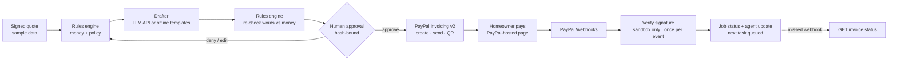

# Praxion Deposit Desk

**Approve-first agentic commerce for in-home sales.** An agent turns a signed quote into a PayPal deposit invoice, checks it against company policy, and waits. A person approves with one tap. PayPal Invoicing sends it with a pay QR code, and PayPal Webhooks bring the result back so the agent can post the next step.

> **Demo only.** PayPal **sandbox** payments: nothing is charged. Every name, address, email and amount in this repository is **fabricated sample data**.

- **Live demo:** `https://<your-render-service>.onrender.com` *(placeholder until deployed)*
- **License:** MIT
- **Stack:** Python 3.11+, FastAPI, SQLite, PayPal Invoicing v2, PayPal Webhooks, an LLM API (optional; there is an offline fallback)

---

## Why

In field sales, the deal is won at the kitchen table and lost in the week after. The quote is signed, the paperwork waits for the office, and the deposit request goes out days later, if at all. Deposit Desk sends the request on the spot. And because it is money, the agent never acts alone: it **asks** for payment, and only after a human says yes to the exact request.

## What it does

1. **Reads the signed quote.** Line items, discount, region and expiry come from the job record.
2. **Drafts the request.** The rules engine sizes the deposit. A language model, called through a server-side API, writes the invoice note and the homeowner message from those facts. Its output is schema-validated. **The model never sets an amount.**
3. **Checks policy before anyone sees it.** Discount authority (rep vs. manager vs. blocked), deposit range, region caps, quote expiry, required fields, and whether every dollar figure in the message matches the quote.
4. **Waits for a person (approve-first).** Approve, edit or deny. The approval binds to the SHA-256 hash of the exact invoice body and message. Any edit creates a new version and voids the approval. Blocked drafts cannot be approved; manager-level discounts need the manager seat.
5. **Sends through PayPal.** `POST /v2/invoicing/invoices` → `POST …/send` → `POST …/generate-qr-code`, with a `PayPal-Request-Id` so a double tap never makes two invoices.
6. **Collects on the spot.** The homeowner scans the QR code and pays the PayPal-hosted invoice.
7. **Listens to PayPal.** `INVOICING.INVOICE.PAID`, `REFUNDED` and `CANCELLED` webhooks are verified (`POST /v1/notifications/verify-webhook-signature`), accepted only from the sandbox, processed once, and applied to the job. The agent posts the update and queues the office's next task.

## Architecture



| Path | Role |
|---|---|
| `app/policy.py` | Deterministic money math and policy flags (`info`, `warn`, `manager`, `block`) |
| `app/drafter.py` | Drafting adapter: LLM client for a chat-completions-style endpoint, plus a deterministic offline drafter and automatic fallback |
| `app/desk.py` | The agent workflow and the approve-first invariants |
| `app/paypal.py` | PayPal sandbox client (OAuth, Invoicing, QR, webhook verification) and an in-process mock with the same interface |
| `app/main.py` | FastAPI routes and server-rendered screens |
| `tests/` | 47 tests: policy, approve-first, webhook verification, idempotency, sandbox client against a faked PayPal HTTP layer |

### Safety properties (each one is tested)

- Nothing reaches PayPal without an `approved` decision on the **exact** draft hash; tampering after approval is refused.
- Edits void approvals. Stale screens (old hash) cannot approve.
- One live deposit invoice per quote; repeat sends return the same invoice.
- Webhooks: signature verified, non-sandbox certificate hosts and links rejected, duplicate event IDs ignored, unknown invoices acknowledged but not applied.
- In sandbox mode invoices go to `SANDBOX_BUYER_EMAIL`, never to the sample customers.
- `PAYPAL_ENV=live` is refused at startup. Card data never touches this server; PayPal hosts payment.
- Rate limits on drafting, sending, webhooks and demo reset. Secrets come from environment variables only.

## Run it

### 1. Local, mock mode (no accounts, no keys, about a minute)

```bash
git clone <this repo> && cd paypal-deposit-desk
python -m venv .venv && . .venv/bin/activate      # Windows: .venv\Scripts\activate
pip install -r requirements-dev.txt
pytest
uvicorn app.main:get_app --factory --reload
```

Open http://127.0.0.1:8000. In mock mode every PayPal call is simulated in-process, and the collect screen has **Simulate payment**, which sends a signed webhook through the same verification path.

### 2. Local or hosted, PayPal sandbox mode

1. At developer.paypal.com, open **Apps & Credentials → Sandbox** and create an app. Copy the client ID and secret.
2. Under **Sandbox → Accounts**, note the sandbox **business** email (the invoicer) and the sandbox **personal** email and password (the payer).
3. In the app's **Webhooks** section, add `https://<your-host>/webhooks/paypal` with the events `Invoicing invoice paid`, `Invoicing invoice refunded` and `Invoicing invoice cancelled`. Copy the **Webhook ID**.
4. `cp .env.example .env` and fill in `PAYPAL_ENV=sandbox`, `PAYPAL_CLIENT_ID`, `PAYPAL_CLIENT_SECRET`, `PAYPAL_WEBHOOK_ID`, `PAYPAL_INVOICER_EMAIL`, `SANDBOX_BUYER_EMAIL` and `PUBLIC_BASE_URL`.
5. Optional: set `LLM_API_URL`, `LLM_API_KEY` and `LLM_MODEL` to draft with a language model. Without them, the offline drafter is used.
6. Run `uvicorn app.main:get_app --factory`. Webhooks need a public HTTPS URL, so use the hosted demo or a tunnel. **Check status with PayPal** on the collect screen works without webhooks.

### Environment variables

`PAYPAL_ENV`, `PAYPAL_CLIENT_ID`, `PAYPAL_CLIENT_SECRET`, `PAYPAL_WEBHOOK_ID`, `PAYPAL_INVOICER_EMAIL`, `SANDBOX_BUYER_EMAIL`, `LLM_API_URL`, `LLM_API_KEY`, `LLM_MODEL`, `PUBLIC_BASE_URL`, `DATABASE_PATH`, `RATE_LIMIT`, `MOCK_WEBHOOK_SECRET`. See `.env.example`. No values are committed.

## For judges: a 3-minute test

1. Open the demo URL. **Pipeline** lists five fabricated signed quotes.
2. Open **Q-1042 → Draft deposit request.** The policy check is clear. Press **Approve**, then **Send through PayPal**.
3. On the collect screen, scan the QR code or press **Open payment page**. Log in with the sandbox payer account from the testing instructions and pay. The screen flips to **Deposit paid** once the webhook arrives, and the agent posts the next step.
4. Try the guardrails:
   - **Q-1043** needs the **Manager** seat (15% discount).
   - **Q-1045** is blocked (25% discount).
   - **Q-1046** is blocked because the quote expired.
   - **Q-1044** shows the agent fitting a sample region cap. Edit it to 30% and the rules block it.
5. **Audit log** shows every decision with its hash, every PayPal invoice, and every verified webhook.

Use **Reset demo** on the pipeline screen to reload the sample data.

## Project status

This is a new, standalone open-source project, built for the PayPal AI Hackathon (2026). It contains no code or data from any other product.

© 2026 Praxion Agentic CRM Solutions. Released under the MIT License.
